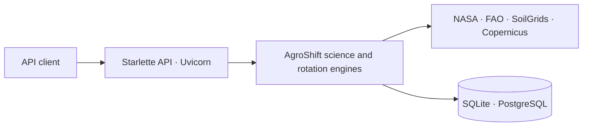

# 🌱 AgroShift Backend

**Evidence-led crop screening, field intelligence, and rotation planning.**

[](https://github.com/senitheknath/nasa-app-challege/actions/workflows/tests.yml?query=branch%3Abackend)


AgroShift combines field conditions, climate and soil evidence, crop requirements, and growing windows to help people investigate crop and rotation options. **This branch contains the Python API and science backend; it does not include a web UI entry point.**

## Contents

- [What it does](#what-it-does)
- [Quick start](#quick-start)
- [Try an API request](#try-an-api-request)
- [API areas](#api-areas)
- [Evidence and limits](#evidence-and-limits)
- [Tests](#tests)
- [Contributing](#contributing)
- [Project status](#project-status)
- [Project map](#project-map)
- [Further reading](#further-reading)

## What it does

| Area | Capabilities |
| --- | --- |
| 🌍 Field context | Location and boundary-aware climate, soil, terrain, and satellite data |
| 🌾 Crop screening | Screens 107 crop identities against reviewed climate, soil, and water traits |
| 🔄 Rotation planning | Ranks feasible crop sequences and returns timelines and scoring details |
| 💧 Water science | FAO-56 reference evapotranspiration and stage-based crop water calculations |
| 📚 Evidence catalogue | Provenance-aware crop, pest, disease, and regional knowledge |
| 🔐 Farm storage | Optional PostgreSQL persistence with per-owner row-level security |



## Quick start

### Prerequisites

- Python **3.14**. The CI workflow uses this version.
- Docker Desktop only if you want the local PostgreSQL development service.
- CI runs on Ubuntu. Windows PowerShell and macOS/Linux commands are shown; other environments are not verified here.

### Install dependencies

Create a virtual environment:

```bash
python -m venv .venv
```

Activate it using the command for your shell:

```powershell
.venv\Scripts\Activate.ps1
```

```bash
source .venv/bin/activate
```

Then install the project and development dependencies:

```bash
python -m pip install -r requirements-dev.txt -r requirements-db.txt
```

### Start the API

```bash
python -m uvicorn api.server:app --host 127.0.0.1 --port 8000 --reload
```

The API listens at `http://127.0.0.1:8000`. Check readiness:

```bash
curl http://127.0.0.1:8000/api/health
```

Expected: HTTP `200` with a JSON object containing `"status": "ok"` and the active knowledge-database status.

### Optional PostgreSQL development database

Start the included local PostgreSQL service when needed:

```bash
python -m scripts.dev_database up
