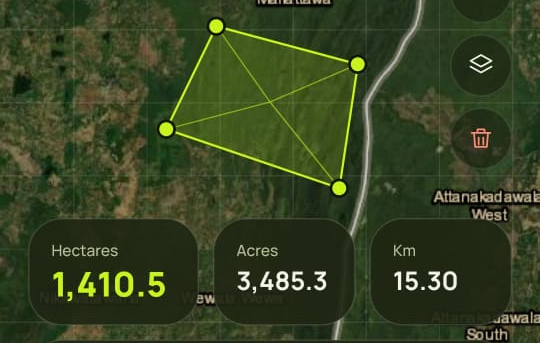
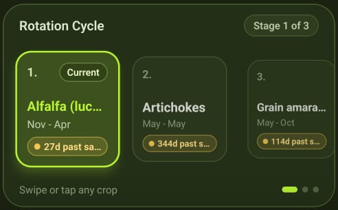
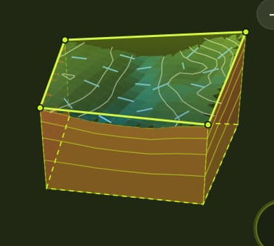
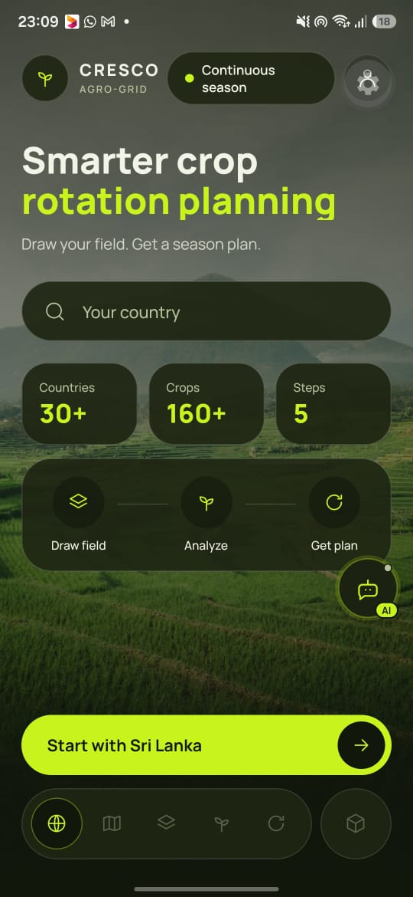

<div align="center">

# CRESCO

**Plan crop rotations with satellite, climate, and soil data.**

AgroShift Mobile · NASA International Space Apps Challenge 2026

[**App walkthrough**](#app-walkthrough) · [**Run on Android**](#quick-start) · [Data sources](#earth-observation-and-agronomy) · [Architecture](#architecture)

</div>


## App walkthrough

Follow a field in Sri Lanka from boundary mapping to a crop rotation plan, then open the 3D monitor to inspect the terrain.

[Field mapping](#map-and-save-fields) · [Crop rotations](#compare-crop-rotations) · [3D monitor](#explore-field-conditions-in-3d) · [Cresco AI](#ask-cresco-ai-about-a-field)

### Map and save fields

<a href="docs/screenshots/field-mapping.png"></a>

Search for a location, then tap the satellite map to trace the field boundary. CRESCO calculates the area in hectares and acres and the perimeter in kilometers.

Sign in to save the field and reopen it when you need a new plan.

<br clear="all">

### Compare crop rotations

<a href="docs/screenshots/rotation-plan.png"></a>

Start with a standing crop or a fallow field. Compare suggested rotations by water demand, soil and nitrogen benefits, pest breaks, and ease of management, or score a set of crops you choose.

The timeline shows sowing deadlines and where a harvest could overlap the next planting window.

<br clear="all">

### Explore field conditions in 3D

<a href="docs/screenshots/field-monitor.png"></a>

Orbit the field model to see how moisture and runoff vary across the terrain. Use the soil cutaway to inspect the layers beneath the field.

Switch to Live Growth to see crop progress and available satellite observations.

<br clear="all">

### Ask Cresco AI about a field

Open the floating chat button and connect a Google Gemini API key. Ask about the selected field, crop, or rotation.

<details>
  <summary>See the chat button on the home screen</summary>
  <br>
  <a href="docs/screenshots/country-selection.png">
    
  </a>
</details>

## Quick start

The Android app is the current focus. The Expo project also includes iOS and web commands for development.

Use Node.js 22.13+ on the 22.x line, Node.js 24.3+ on the 24.x line, or Node.js 26+, with npm. Native Android builds require Android Studio and the Android SDK.

```bash
git clone --branch app https://github.com/senitheknath/nasa-app-challege.git
cd nasa-app-challege/mobile
npm ci
npm start
```

Press `a` in the Expo terminal to open a running Android emulator. To build and install the native app, run `npm run android`.

### Connect a backend

Without a local override, the app uses the hosted AgroShift API at `https://agro.332536.xyz`. For a self-hosted API, set `EXPO_PUBLIC_API_BASE_URL` in `mobile/.env.local` before starting Expo, or set the server address in the app’s settings. Use an address reachable from the device, such as your computer’s LAN IP when testing on a physical phone. [Backend setup](https://github.com/senitheknath/nasa-app-challege/tree/main#quick-start)

## Earth observation and agronomy

The AgroShift backend combines Earth observation and agronomic references to estimate field conditions and screen crop rotations. Which observations appear in the app depends on data available for the field and date.

| Source | Role in AgroShift |
| --- | --- |
| NASA POWER | Historical temperature, rainfall, solar radiation, and soil wetness for agroclimatology |
| Copernicus DEM | Elevation and slope for the terrain view and runoff modeling |
| Sentinel-1 and Sentinel-2 | Radar and optical observations used in wetness and vegetation estimates |
| NASA SMAP and Harmonized Landsat Sentinel-2 (HLS) | Additional soil moisture and vegetation observations |
| ISRIC SoilGrids | Soil pH and texture at multiple depths for field profiles |
| FAO-56 and FAO GAEZ | Crop water requirements and agroclimatic suitability for crop screening |

[Source inventory and modeling details](https://github.com/senitheknath/nasa-app-challege/tree/main#verified-space-agency--agricultural-data-sources)

## Architecture

The AgroShift API processes Earth observation and agronomic data. The CRESCO client validates the API responses with Zod and presents them in the planner and monitor. TanStack Query manages requests and caching, and Zustand holds planner state.

| Layer | Where to look |
| --- | --- |
| Expo SDK 58, React Native 0.88, TypeScript, and Expo Router | [App routes](mobile/src/app) · [Package manifest](mobile/package.json) |
| Field mapping, crop screening, rotation planning, 3D monitoring, and Cresco AI | [Feature modules](mobile/src/features) |
| HTTP client, endpoint definitions, and session handling | [API client](mobile/src/api) · [API contract](mobile/API_CONTRACT.md) |
| Starlette API and scientific models | [AgroShift backend](https://github.com/senitheknath/nasa-app-challege/tree/backend) |

### Development commands

Run these commands from `mobile/`.

| Command | Purpose |
| --- | --- |
| `npm start` | Start the Expo development server |
| `npm run android` | Build and run the native Android app |
| `npm run ios` | Build and run the native iOS app on macOS |
| `npm run web` | Start the browser development preview |
| `npm run lint` | Check code style and rules |
| `npm run typecheck` | Check TypeScript types |
| `npm test` | Run the Jest suite |

## License

Released under the [MIT License](LICENSE). Source datasets are subject to their providers’ terms.
