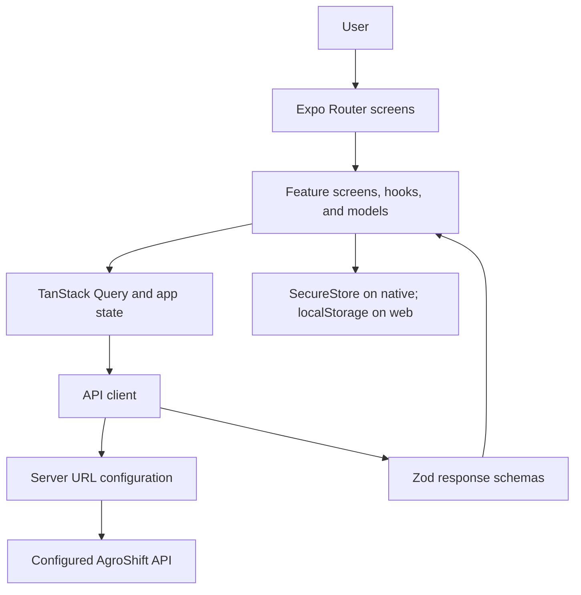

# CRESCO Mobile App

A cross-platform Expo app for field mapping, crop selection, rotation planning, field monitoring, and Cresco chat.

[](https://docs.expo.dev/versions/v58.0.0/)
[](https://reactnative.dev/)
[](LICENSE)

## Table of Contents

- [Overview](#overview)
- [Features](#features)
- [Tech Stack](#tech-stack)
- [Architecture](#architecture)
- [Prerequisites](#prerequisites)
- [Installation](#installation)
- [Configuration](#configuration)
- [Running the App](#running-the-app)
- [Backend API Integration](#backend-api-integration)
- [Testing and Code Quality](#testing-and-code-quality)
- [Build and Deployment](#build-and-deployment)
- [Security and Privacy](#security-and-privacy)
- [Troubleshooting](#troubleshooting)
- [Contributing](#contributing)
- [License](#license)
- [Acknowledgements](#acknowledgements)

## Overview

CRESCO is a mobile app for exploring agricultural locations, drawing field boundaries, choosing crops, and reviewing crop-rotation plans. It also provides field-monitoring views and an optional Cresco chat experience. The app runs on iOS, Android, and web through Expo and obtains agricultural data from a separately configured API server. The mobile branch contains the client application; it does not contain the backend service.

## Features

- Browse countries, locations, crop categories, and crops.
- Draw a field boundary and view area and perimeter measurements.
- Select a farming strategy and crop, then request a rotation plan.
- View climate, satellite, and 3D field-monitoring information.
- Save and load farms through the API.
- Sign in or register with the API and keep the bearer token in platform storage.
- Connect Cresco chat with a user-provided Gemini API key.
- Change the API server address in the app; the selected address persists locally.

## Tech Stack

| Technology | Version | Purpose |
|---|---:|---|
| Node.js | TODO: declare the supported Node.js version | JavaScript runtime for the Expo toolchain |
| Expo | `~58.0.25` | App framework and development/build tooling |
| React Native | `0.88.1` | Native iOS and Android UI |
| React | `19.3.0` | UI component library |
| TypeScript | `~6.0.3` | Static typing |
| Expo Router | `~58.0.31` | File-based navigation |
| TanStack Query | `^5.107.1` | Server-state and request caching |
| Zod | `^4.6.7` | Runtime validation for API responses |
| Zustand | `^5.1.0` | Client-side state |
| Jest / jest-expo | `~30.5.2` / `~58.0.14` | Unit and component tests |
| ESLint / eslint-config-expo | `^9` / `~58.0.4` | Linting |

Exact dependency declarations are in [`mobile/package.json`](mobile/package.json), with resolved dependency versions in `mobile/package-lock.json`.

## Architecture



The app routes live in `mobile/src/app/`. Feature-specific screens, request hooks, and models live in `mobile/src/features/`. Shared networking, server configuration, and session handling live in `mobile/src/api/`.

```text
mobile/
  app.json                  Expo app identity, platform settings, and plugins
  package.json              Dependencies and npm scripts
  src/
    app/                    Expo Router screens and navigation layout
    api/                    HTTP client, endpoint methods, server config, session
    components/             Shared UI components
    features/
      area/                 Country and field selection
      auth/                 Login and account state
      country/              Country selection and data
      cresco/               Cresco connection, chat, and models
      crop/                 Crop catalogue and selection
      monitor/              Climate, satellite, and field-monitoring views
      plan/                 Rotation planning and plan models
      planner/              Planner flow
      strategy/             Strategy selection
    state/                  Shared planner state
    theme/                  Colors, typography, images, and theme hooks
    utils/                  Formatting and platform helpers
  tests/                    Jest tests
  API_CONTRACT.md           Client-facing API contract document
  jest.config.cjs           Jest configuration
  eslint.config.js          ESLint configuration
  tsconfig.json             TypeScript configuration
```

## Prerequisites

- Node.js: supported version is not specified in the repository.
- npm and a compatible iOS, Android, or web development environment for the platform you want to run.
- A reachable backend API. The default server URL is configured in `mobile/src/api/config.ts`.

## Installation

1. Clone the `app` branch:

   ```bash
   git clone -b app --single-branch https://github.com/senitheknath/nasa-app-challege.git
   cd nasa-app-challege/mobile
   ```

2. Install dependencies using the committed lockfile:

   ```bash
   npm ci
   ```

3. Configure the API server if needed. See [Configuration](#configuration).

## Configuration

The app reads one Expo public environment variable:

| Variable | Description | Required | Default |
|---|---|---:|---|
| `EXPO_PUBLIC_API_BASE_URL` | Default base URL for the API client. The app trims trailing slashes. | No | `https://agro.332536.xyz` |

The checked-in `mobile/.env.example` uses `http://127.0.0.1:8000`. Copy it to `.env` to use that local API address:

```bash
cp .env.example .env
```

On Windows PowerShell:

```powershell
Copy-Item .env.example .env
```

For a physical device, `127.0.0.1` refers to the device itself. Set the variable to an address reachable from the device, or change the server URL in the app. The server setting is stored with Expo SecureStore on native platforms and in browser local storage on web.

`EXPO_PUBLIC_*` variables are bundled into the client app. Do not put secrets in them. Cresco’s Gemini key is entered by the user through the app and sent to the backend’s Cresco connection endpoint.

## Running the App

Run these commands from `mobile/`.

Start the Expo development server:

```bash
npm run start
```

Start for a specific target:

```bash
npm run android
npm run ios
npm run web
```

The `android` and `ios` scripts invoke Expo native run commands and require the corresponding local platform tooling. The web script starts the Expo web target.

## Backend API Integration

The mobile client calls a separately deployed API server. The base URL comes from `EXPO_PUBLIC_API_BASE_URL`, defaults to `https://agro.332536.xyz`, and can be changed in app settings. The client sends JSON requests, attaches `Authorization: Bearer <token>` when a token is available, and validates many response payloads with Zod schemas.

The mobile client does not call NASA services directly. The backend supplies the crop, climate, satellite, field, and monitoring data used by the app.

### API operations used by the app

| Method | Path | Purpose |
|---|---|---|
| `GET` | `/api/system/presets` | Load system presets and country/station data. |
| `GET` | `/api/knowledge/status` | Read knowledge-store status and crop count. |
| `GET` | `/api/earth-data/places` | Search or list places by country and optional query. |
| `GET` | `/api/earth-data/layers` | Load available map layers. |
| `GET` | `/api/knowledge/categories` | Load crop categories and optional regional context. |
| `GET` | `/api/knowledge/crops` | Search and paginate crops. |
| `POST` | `/api/earth-data/autofill` | Retrieve field context from a location or boundary. |
| `POST` | `/api/agronomy/rotations` | Request crop-rotation options. |
| `POST` | `/api/earth-data/monitor-3d` | Request 3D field-monitoring data. |
| `POST` | `/api/earth-data/prefetch` | Ask the backend to warm field-data caches. |
| `POST` | `/api/earth-data/satellite` | Request satellite context. |
| `POST` | `/api/earth-data/climate` | Request climate information. |
| `POST` | `/api/auth/login` | Authenticate a user. |
| `POST` | `/api/auth/register` | Register a user. |
| `GET` | `/api/auth/me` | Retrieve the current user. |
| `GET` | `/api/farms` | List saved farms. |
| `POST` | `/api/farms` | Create a saved farm. |
| `PUT` | `/api/farms/{farm_id}` | Update a saved farm. |
| `DELETE` | `/api/farms/{farm_id}` | Delete a saved farm. |
| `POST` | `/api/cresco/connect` | Connect a Cresco session using a user-supplied API key. |
| `GET` | `/api/cresco/status` | Retrieve Cresco session status. |
| `POST` | `/api/cresco/chat` | Send a Cresco chat message. |
| `POST` | `/api/cresco/clear` | Clear Cresco conversation history. |
| `POST` | `/api/cresco/disconnect` | Disconnect the Cresco session. |

Example request to the configured API:

```bash
curl "$EXPO_PUBLIC_API_BASE_URL/api/system/presets"
```

Example login request:

```bash
curl -X POST "$EXPO_PUBLIC_API_BASE_URL/api/auth/login" \
  -H "Content-Type: application/json" \
  -d '{"email":"farmer@example.com","password":"example-password"}'
```

The login response is expected to include a token and user:

```json
{
  "token": "<bearer-token>",
  "user": {
    "id": 1,
    "email": "farmer@example.com",
    "display_name": "Farmer"
  }
}
```

The repository’s client API types and schemas are the source for client expectations. Backend API behavior and provider attribution are documented in the backend repository branch.

## Testing and Code Quality

Run the scripts defined in `mobile/package.json`:

```bash
npm test
npm run lint
npm run typecheck
```

The Jest configuration uses `jest-expo` and matches tests in `mobile/tests/`. The test files cover API client behavior, Cresco flows, date/expiry behavior, hooks, saved-farm loading, models, and terrain geometry. The repository does not declare a coverage threshold or a CI workflow for this mobile branch.

## Build and Deployment

The repository includes Expo app configuration for iOS, Android, and web, plus plugins for Expo Router, splash screen, SecureStore, and the community date-time picker. No EAS build profile or store-submission configuration is present in the mobile branch.

Use the Expo development and platform scripts above for local development. TODO: document the production build, signing, and store-release process once the project’s release configuration is defined.

## Security and Privacy

- The API client stores an available bearer token using the app’s session storage implementation.
- The API server address is saved in SecureStore on native platforms and browser local storage on web.
- The API client treats HTTP 401 as an expired session and attempts to clear that session.
- The app’s configurable server URL is validated and normalized before it is saved.
- The Cresco API key is user-provided. Do not place it in an Expo public environment variable.
- The API base URL is configuration, not a secret; requests may include user credentials and farm data.

## Troubleshooting

- **The app cannot reach the API:** Confirm the configured base URL is reachable from the device. A device cannot generally use its own `127.0.0.1` to reach a development machine.
- **The app uses an unexpected server:** Check `EXPO_PUBLIC_API_BASE_URL` and the saved server override in app settings.
- **Login appears to reset:** The API client handles a 401 response as session expiry. Sign in again and confirm the backend accepts the token.
- **Cresco connection fails:** Verify the user-supplied Gemini key and the backend’s Cresco integration. The mobile app does not make Gemini requests directly.
- **Native run command fails:** Check the local Android or iOS development setup required by Expo’s native run command.

## Contributing

This README documents the `app` branch, which contains the mobile application. Create changes against that branch and open a pull request targeting the repository’s intended integration branch. No commit-message convention is specified in the mobile package or app configuration.

Before submitting, run:

```bash
npm test
npm run lint
npm run typecheck
```

## License

The repository root includes an MIT License. See [`LICENSE`](../LICENSE). The `mobile/` directory also contains an MIT license file.

## Acknowledgements

The app uses Expo, React Native, and the libraries listed in `mobile/package.json`. It presents NASA-related and other agricultural data through the configured backend API. The mobile branch does not identify a NASA Space Apps Challenge year, challenge category, or team roster.
