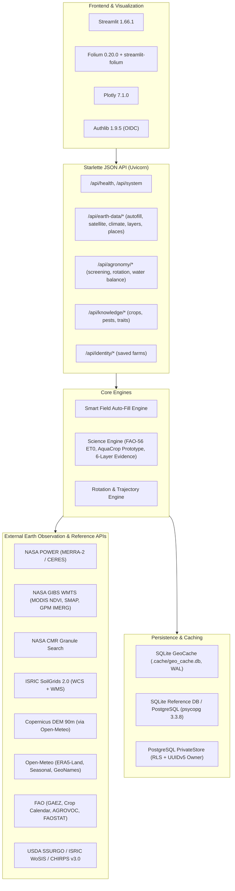

# AgroShift Technology Stack & Architecture Reference

This document provides a detailed breakdown of the technologies, scientific models, data pipelines, monitoring layers, APIs, and storage systems used in `agroshift_dev`.

---

## 1. High-Level Architecture

---

## 2. Web Framework, API & UI Stack

### 2.1 Backend JSON API (`api/`)
- **Starlette (`>=0.40.0`)** ([api/server.py](file:///home/theshan/projects/nasa/agroshift_dev/api/server.py)): Lightweight ASGI framework serving the modular JSON API with `CORSMiddleware` enabled.
- **Uvicorn (`>=0.30.0`)**: ASGI server running the Starlette application.
- **Concurrency:** CPU/network-bound earth-data and scientific computations are offloaded from the async event loop via `starlette.concurrency.run_in_threadpool`.
- **Modular Route Groups** ([api/routes/__init__.py](file:///home/theshan/projects/nasa/agroshift_dev/api/routes/__init__.py)):
  - `system.py` — System health and metadata
  - `earth_data.py` — `POST /api/earth-data/autofill`, `POST /api/earth-data/satellite`, `POST /api/earth-data/climate`, `GET /api/earth-data/layers`, `GET /api/earth-data/places`
  - `agronomy.py` — Crop screening, water balance, and rotation endpoints
  - `knowledge.py` — Crop catalogue, traits, growth stages, and pest context
  - `identity.py` — Authenticated farm profile persistence

### 2.2 Frontend & Geospatial UI (`requirements.txt`)
- **Streamlit (`1.66.1`)**: Interactive web UI for field setup, screening reports, and climate/soil exploration.
- **Folium (`0.20.0`) & `streamlit-folium` (`0.27.4`)**: Interactive Leaflet maps for drawing field boundary polygons and rendering NASA GIBS WMTS / ISRIC SoilGrids WMS overlays.
- **Plotly (`7.1.0`)**: Interactive climate, climatology, water-balance, and crop-timeline charts.
- **Authlib (`1.9.5`)** ([requirements-db.txt](file:///home/theshan/projects/nasa/agroshift_dev/requirements-db.txt)): Optional OIDC authentication integration for Streamlit sessions.

---

## 3. Earth Observation, Live Monitoring & Auto-Fill (`agroshift/earth_data/`)

### 3.1 Live Satellite Monitoring Layers ([satellite.py](file:///home/theshan/projects/nasa/agroshift_dev/agroshift/earth_data/satellite.py))
`get_active_monitoring_layers` exposes global map overlay endpoints (with configurable lag days from `config/platform.json`):

| Layer ID | Provider / Protocol | Resolution | Native Zoom | Source Endpoint |
| :--- | :--- | :--- | :--- | :--- |
| `smap_surface_soil_moisture` | NASA GIBS WMTS (`EPSG:3857`) | 9 km | Level 6 | `SMAP_L3_Passive_Enhanced_Day_Soil_Moisture` |
| `modis_vegetation_vigor_ndvi` | NASA GIBS WMTS (`EPSG:3857`) | 250 m | Level 9 | `MODIS_Terra_NDVI_8Day` |
| `gpm_imerg_precipitation_rate` | NASA GIBS WMTS (`EPSG:3857`) | 10 km (0.1°) | Level 6 | `IMERG_Precipitation_Rate` |
| `soilgrids_ph` | ISRIC SoilGrids 2.0 WMS | 250 m | Static (2020) | `https://maps.isric.org/mapserv?map=/map/phh2o.map` (`phh2o_0-5cm_mean`) |
| `soilgrids_clay` | ISRIC SoilGrids 2.0 WMS | 250 m | Static (2020) | `https://maps.isric.org/mapserv?map=/map/clay.map` (`clay_0-5cm_mean`) |

- **Satellite Overpass Scheduling:** `fetch_satellite_overpasses` queries **NASA CMR Granules API** (`https://cmr.earthdata.nasa.gov/search/granules.json`) for Harmonized Landsat (30 m), ECOSTRESS (70 m), and SMAP (9 km) granules intersecting the field point or polygon bounding box.

### 3.2 Smart Field Auto-Fill Engine ([autofill.py](file:///home/theshan/projects/nasa/agroshift_dev/agroshift/earth_data/autofill.py))
`derive_field_autofill` populates initial farm setup parameters without guesswork, keeping every field attributed and overridable (`can_override: true`):
1. **Soil pH (0–5 cm):** Queries **ISRIC SoilGrids 2.0 WCS** (`GetCoverage`, `COVERAGEID=phh2o_0-5cm_mean`, `FORMAT=GEOTIFF_INT16`, 5×5 raster). Parsed in-memory using **Pillow (`13.0.0`)** and scaled by `raw / 10`.
2. **Terrain & Drainage Prior:** Samples **Copernicus DEM 90 m** (via Open-Meteo Elevation API) over an adaptive polygon grid or centroid to derive `elevation_m`, `elevation_min_m`, `elevation_max_m`, `regional_slope_pct`, and `suggested_drainage_prior` (with a safe `"well_drained"` heuristic fallback if unreachable).
3. **Geodetic Field Area:** Computes exact geodetic area in hectares and acres from drawn GeoJSON/UI polygons via `polygon_area_hectares`.
4. **Climate & Soil Moisture Carryover:** Extracts 25-year medians/means from NASA POWER (`PRECTOTCORR`, `T2M`, `GWETROOT`, `GWETTOP`).

### 3.3 Multi-Provider Earth & Reference Connectors ([providers.py](file:///home/theshan/projects/nasa/agroshift_dev/agroshift/earth_data/providers.py), [power.py](file:///home/theshan/projects/nasa/agroshift_dev/agroshift/science/climate/power.py))
- **NASA POWER (`https://power.larc.nasa.gov/api/temporal/daily/point`):** 25-year daily agroclimatology (MERRA-2 / CERES reanalysis).
- **Copernicus ERA5-Land (`https://archive-api.open-meteo.com/v1/archive`):** Historical reanalysis climate data.
- **Open-Meteo Seasonal Forecast (`https://seasonal-api.open-meteo.com/v1/seasonal`):** Sub-seasonal/seasonal outlook.
- **GeoNames via Open-Meteo (`geography.py`):** Global place-name search and administrative region resolution.
- **UCSB CHIRPS v3.0 (`https://data.chc.ucsb.edu/products/CHIRPS/v3.0/`):** High-resolution gridded rainfall.
- **USDA SSURGO (`https://sdmdataaccess.sc.egov.usda.gov/`) & ISRIC WoSIS (`https://www.isric.org/explore/wosis`):** Regional soil survey and point profile evidence.
- **FAO Data Sources:** **GAEZ** (agro-ecological suitability), **FAO Crop Calendar API**, **AGROVOC** (agricultural thesaurus), and **FAOSTAT**.

---

## 4. Scientific, Data Science & Agronomy Engines (`agroshift/science/`, `agroshift/rotation/`)

### 4.1 Numerical & Data Processing Core
- **Pandas (`3.1.1`) & NumPy (`2.5.4`)**: Vectorized time-series processing for multi-decade daily climate frames, monthly climatologies, and daily water-balance integration.
- **pycountry (`26.2.16`)**: ISO 3166 country/region normalization.

### 4.2 Soil & Water Balance Models (`agroshift/science/soil_water/`)
- **FAO-56 Penman-Monteith $ET_0$ ([water_balance.py](file:///home/theshan/projects/nasa/agroshift_dev/agroshift/science/soil_water/water_balance.py)):**
  - Computes daily extraterrestrial radiation $R_a$ (`extraterrestrial_radiation_mj`, FAO-56 Eq. 21–25).
  - Computes daily reference evapotranspiration $ET_0$ using temperature, relative humidity / dewpoint, solar radiation (`ALLSKY_SFC_SW_DWN`), and wind speed (`WS2M`/`WS10M`), with automatic **Hargreaves fallback** when wind or radiation series are absent.
  - Simulates daily root-zone crop water balance across crop growth-stage fractions.
- **FAO Paper 66 / AquaCrop Prototype ([aquacrop_prototype.py](file:///home/theshan/projects/nasa/agroshift_dev/agroshift/science/soil_water/aquacrop_prototype.py)):**
  - Water-driven daily canopy cover (`cc0`, `ccx`), transpiration, and biomass simulation (`wp_star_g_m2`, `hi0`, `kcb_max`, `ky`).
  - Strictly isolated from primary crop screening (`find_options`) and explicitly tagged with `simulation=True` and `data_category="hypothetical_simulation"`.
- **Soil Evidence Reconciliation ([soil.py](file:///home/theshan/projects/nasa/agroshift_dev/agroshift/science/soil_water/soil.py)):** Reconciles farmer-measured soil values against modelled SoilGrids/SSURGO surfaces without overwriting user measurements.

### 4.3 Climate Insights & Extremes (`agroshift/science/climate/`)
- **Climatology & Growing Period ([climate_insights.py](file:///home/theshan/projects/nasa/agroshift_dev/agroshift/science/climate/climate_insights.py)):** Computes 12-month climatologies, site summaries, and optimal planting window suggestions.
- **Extremes Analysis ([extremes.py](file:///home/theshan/projects/nasa/agroshift_dev/agroshift/science/climate/extremes.py)):** Evaluates heat-stress, dry-spell, and heavy-rainfall risk from historical daily distributions.

### 4.4 Screening & 6-Layer Evidence Synthesis (`agroshift/science/decision/`)
- **Crop Screening ([screening.py](file:///home/theshan/projects/nasa/agroshift_dev/agroshift/science/decision/screening.py)):** Evaluates crop compatibility against site climate, soil pH, drainage, and water availability.
- **6-Layer Evidence Combination ([evidence_combination.py](file:///home/theshan/projects/nasa/agroshift_dev/agroshift/science/decision/evidence_combination.py)):** Synthesizes evidence across Layers A–F while preventing double-counting of correlated models, classifying options into `worth_investigating`, `conditional_compatibility`, `important_constraints`, `not_compatible`, or `insufficient_evidence`.

### 4.5 Crop Rotation & Sequence Engine (`agroshift/rotation/`)
- **Rule-Based Transition Evaluator ([engine.py](file:///home/theshan/projects/nasa/agroshift_dev/agroshift/rotation/engine.py), [rules.py](file:///home/theshan/projects/nasa/agroshift_dev/agroshift/rotation/rules.py)):** Evaluates consecutive crop transitions using composable `TransitionRule` contracts (botanical family, pest/disease carryover, nutrient/legume effects, timing).
- **Timeline & Trajectory Solver ([timeline_adapter.py](file:///home/theshan/projects/nasa/agroshift_dev/agroshift/rotation/timeline_adapter.py), [timeline_core.py](file:///home/theshan/projects/nasa/agroshift_dev/agroshift/rotation/timeline_core.py)):** Quantizes crops into physical activity windows and solves valid multi-season rotation trajectories under `ArcConstraint`s.

---

## 5. Persistence, Caching & Security (`db/`, `agroshift/identity/`)

- **Spatial GeoCache ([cache.py](file:///home/theshan/projects/nasa/agroshift_dev/agroshift/earth_data/cache.py)):** Local **SQLite** database (`.cache/geo_cache.db`) configured with `PRAGMA journal_mode=WAL` and `PRAGMA synchronous=NORMAL`, caching cell-based environmental, soil, and autofill payloads with source attribution and timestamps.
- **Knowledge & Reference Store ([knowledge_store.py](file:///home/theshan/projects/nasa/agroshift_dev/agroshift/science/knowledge/knowledge_store.py)):** Versioned SQLite offline reference database and optional **PostgreSQL** (`psycopg[binary]==3.3.8`) backend with `agroshift` schema isolation and statement timeouts.
- **Private Farm Repository ([private_store.py](file:///home/theshan/projects/nasa/agroshift_dev/agroshift/identity/private_store.py)):**
  - Derives deterministic `UUIDv5` owner IDs from verified OIDC (`iss`, `sub`) claims.
  - Enforces **PostgreSQL Row-Level Security (RLS)** and explicitly verifies that the database role does not hold `rolsuper` or `rolbypassrls`.

---

## 6. Runtime, Testing & Deployment

- **Python Runtime:** Python 3.14 (`.venv`).
- **Testing:** `pytest` configured via [pyproject.toml](file:///home/theshan/projects/nasa/agroshift_dev/pyproject.toml) (`testpaths = ["tests"]`), covering science models, global providers, geography, autofill, satellite layers, and farm workspaces.
- **Containerization:** [Dockerfile](file:///home/theshan/projects/nasa/agroshift_dev/Dockerfile) and [compose.database.yml](file:///home/theshan/projects/nasa/agroshift_dev/compose.database.yml) for containerized API/UI and PostgreSQL database deployment.
